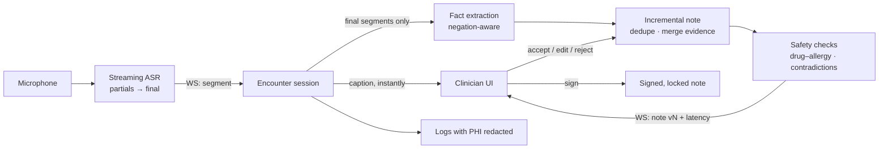

# realtime-clinical-notes-demo

[](https://github.com/ndanetaadmire-debug/realtime-clinical-notes-demo/actions/workflows/ci.yml)


**How an AI clinical scribe works, as a runnable demo.** A consultation streams in as speech, a structured SOAP note builds itself in real time, every line links back to the words it came from, and nothing reaches the record until a clinician reviews and signs it.

> I co-architected **Scribe**, the AI clinical co-pilot at Gerko. This repository is an **independent, from-scratch demo** of the same class of system, written to explain the architecture publicly. It contains **no Gerko code**, uses only **synthetic consultations**, and is **not a medical device**.

```
$ npm run demo
Pt | I've had a sore throat and a fever for three days, and a bit of a cough.
   ↳ note v1: +Fever  +Sore throat  +Cough  +Duration: three days
Pt | No shortness of breath, no chest pain.
   ↳ note v2: +Denies shortness of breath  +Denies chest pain
Pt | I've been taking paracetamol. Oh, and I'm allergic to penicillin.
Dr | Okay. Your temperature is 38.4 and your heart rate is 96. Sats are 98 percent.
Dr | I'll prescribe azithromycin 500 mg once a day for three days.
...
S:  Fever · Sore throat · Cough · Duration: three days · Denies shortness of breath · Denies chest pain
    Allergy: Penicillin · Current medication: Paracetamol
O:  Temperature 38.4 °C · Heart rate 96 bpm · SpO₂ 98% · Exam: Tonsils are swollen with white exudate
A:  Bacterial tonsillitis
P:  Prescribe Azithromycin 500 mg once a day for three days · Follow up if you're not better in 48 hours
```

## Pipeline



## Design decisions that matter clinically

| Decision | Why |
|---|---|
| **Every note item cites its transcript segment(s)** | The clinician can verify any line in one click. A line with no evidence can't exist. |
| **The note updates only on final segments**; partials drive the live caption | Recognition revises itself mid-sentence; a note that flickers is a note nobody trusts |
| **Negation is resolved per clause** | "No fever, but a terrible headache" → *Denies fever* + *Headache*. Getting this wrong inverts meaning |
| **Pertinent negatives are first-class** | "Denies chest pain" is clinically important, not noise |
| **Drug–allergy class check** | Prescribing amoxicillin with a documented penicillin allergy raises a **critical** alert that blocks sign-off |
| **Contradictions are flagged, never resolved by guessing** | "I've got a fever" … "No fever actually" → warning for the clinician |
| **Duplicates merge evidence** | A symptom mentioned three times is one line with three citations |
| **Human in the loop by construction** | Every suggestion must be accepted, edited or rejected before signing; rejected items stay out of the note; signing locks it |
| **PHI-safe logging** | ID numbers, phone numbers, emails, dates and the encounter's known patient names are redacted from every log line |
| **Versioned WebSocket protocol, validated with Zod** | Malformed or unversioned messages get an error frame; the connection survives |

## Production vs demo

| Concern | This demo | Production system |
|---|---|---|
| Speech recognition | Scripted stream with realistic partials | Streaming medical ASR with diarisation |
| Fact extraction | Deterministic rules (offline, testable) | LLM with a strict output schema; the same contract: evidence-linked items, negation, no inference |
| Drug knowledge | Small class table | Formulary and interaction database |
| Storage | In-memory | Encrypted, access-controlled clinical record with an audit trail |

The extraction step is deliberately a swappable boundary: replacing the rules with an LLM changes the quality ceiling, not the safety contract the rest of the pipeline enforces.

## Protocol

`ws://host/v1/encounters/{id}/stream`

| Client → server | Server → client |
|---|---|
| `{ v:1, type:"segment", segment }` | `ready` (current note) · `transcript` (caption) · `note` (vN + `latencyMs`) |
| `{ v:1, type:"review", itemId, action: "accept" \| "reject" \| { edit } }` | `note` |
| `{ v:1, type:"sign", clinician }` | `signed` (note + rendered SOAP) or `error` |

## Tests

Clause-level negation, durations, allergies, medications, vitals, structured prescriptions, partials ignored, finals immutable, evidence merging, the critical drug–allergy alert blocking sign-off, contradiction warnings, review/edit/reject, signing and locking, PHI redaction, and the full consultation over a real WebSocket (captions, versioned note updates with latency, review and sign-off, malformed-message resilience, names redacted from logs).

```bash
npm ci
npm run demo     # offline walkthrough
npm run dev      # WebSocket server on :8080
npm run ci       # typecheck + 15 tests (97% coverage) + build
```

---

Built by **[Admire T. Ndaneta](https://admire-portfolio.vercel.app)**. MIT licensed. Synthetic data only; not for clinical use.
